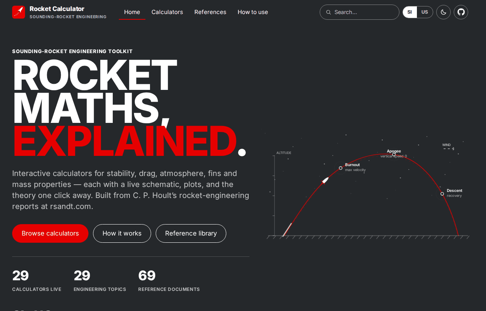
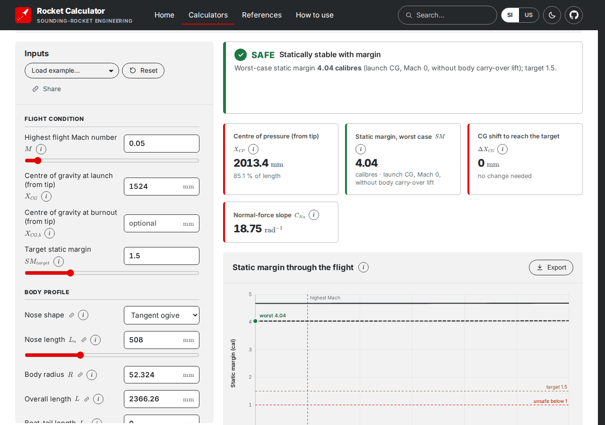
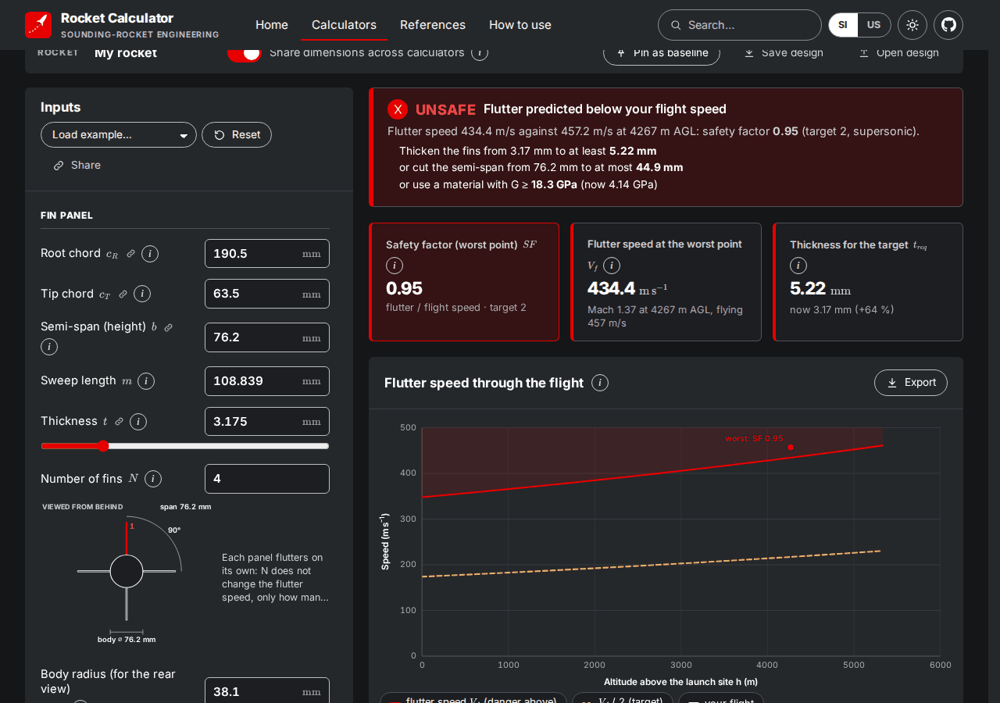
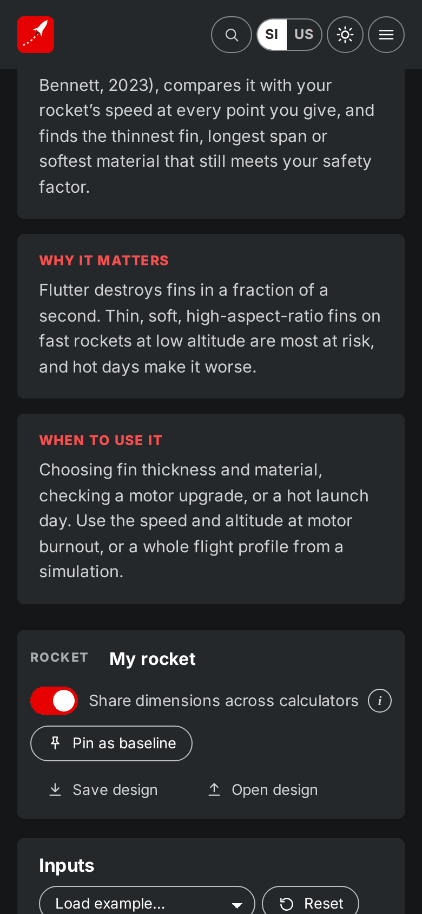
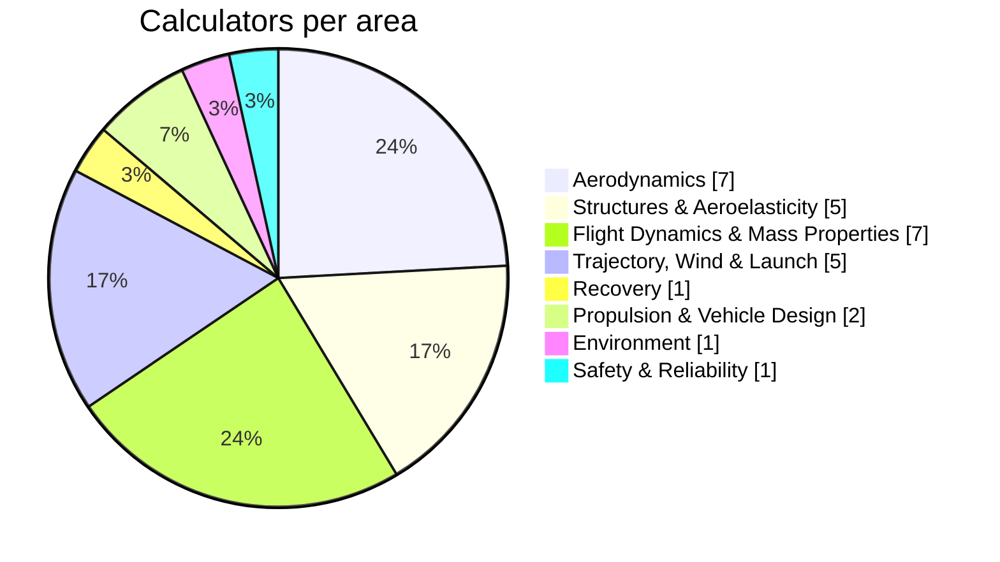
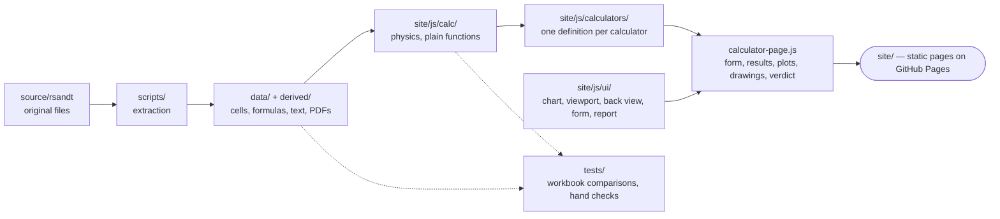

# Rocket Calculator

**Sounding-rocket engineering, explained — 29 interactive calculators with live diagrams, plots and the theory one click away.**

**Live: <https://rocketcalculator.github.io/>**

An open-source rebuild of the rocket-engineering reports and Excel workbooks of C. P. Hoult at
[rsandt.com](http://www.rsandt.com/reports.html), as a static website: no server and no build step.
Every calculator gives a **verdict** where one applies (SAFE / MARGINAL / UNSAFE, with the changes that fix it), shows
its geometry in a **scaled drawing**, plots the results, and links to a **theory page** and the **original references**
(69 documents in the reference library).



| Subsonic CP — verdict on the worst-case static margin | Fin Flutter — flutter speed through the flight |
|---|---|
|  |  |



## What you get
- **SI / US units** everywhere (inputs, results, plots, drawings, reports), light and dark themes.
- **Share a rocket across calculators:** enter the body and fins once; save and open designs; pin a baseline and compare.
- **Diagrams you can use:** zoom and pan, drag handles on the drawing to change inputs, rear view for every fin-count input.
- **Reports:** every calculation produces a worked report (inputs, equations with your numbers, results, references) as a
  preview, Markdown or LaTeX; plots and drawings export as CSV/XLSX/JSON, SVG/PDF/EPS and PNG/JPEG.
- **Works on a phone** (320 px and up).

## The calculators
| Area | Calculators |
|---|---|
| Aerodynamics | [Subsonic Centre of Pressure](https://rocketcalculator.github.io/calculators/subsonic-cp.html), [Zero-Lift Drag Coefficient](https://rocketcalculator.github.io/calculators/drag-coefficient.html), [Modified Newtonian Drag](https://rocketcalculator.github.io/calculators/newtonian-drag.html), [Nose Pressure Distribution](https://rocketcalculator.github.io/calculators/nose-pressure.html), [Ogive Nose Profile](https://rocketcalculator.github.io/calculators/ogive-nose.html), [Optimum Nose Shape](https://rocketcalculator.github.io/calculators/optimum-nose.html), [Single Wedge Airfoil](https://rocketcalculator.github.io/calculators/single-wedge.html) |
| Structures & Aeroelasticity | [Upper-Stage Divergence](https://rocketcalculator.github.io/calculators/upper-stage-divergence.html), [Body Bending Modes](https://rocketcalculator.github.io/calculators/body-bending.html), [Fin Flutter](https://rocketcalculator.github.io/calculators/fin-flutter.html), [Ground Handling Loads](https://rocketcalculator.github.io/calculators/ground-handling.html), [Payload Bay Venting](https://rocketcalculator.github.io/calculators/payload-venting.html) |
| Flight Dynamics & Mass Properties | [Bifilar Pendulum Inertia](https://rocketcalculator.github.io/calculators/bifilar-pendulum.html), [Fin Cant Angle & Roll Rate](https://rocketcalculator.github.io/calculators/fin-cant-angle.html), [Pitch-Yaw Wave Number](https://rocketcalculator.github.io/calculators/pitch-yaw-wavenumber.html), [Propellant Sloshing](https://rocketcalculator.github.io/calculators/propellant-slosh.html), [Roll Lock-In](https://rocketcalculator.github.io/calculators/roll-lock-in-design.html), [Roll Rate History](https://rocketcalculator.github.io/calculators/roll-rate-history.html), [Yo-Yo Despinner](https://rocketcalculator.github.io/calculators/yo-yo-despin.html) |
| Trajectory, Wind & Launch | [Flight Path Angle Dispersions](https://rocketcalculator.github.io/calculators/flight-path-dispersion.html), [Launcher Rail Deflection](https://rocketcalculator.github.io/calculators/launcher-deflection.html), [Trajectory Simulation (SKYAERO)](https://rocketcalculator.github.io/calculators/skyaero-trajectory.html), [Wind Compensation](https://rocketcalculator.github.io/calculators/wind-compensation.html), [Tethered Balloon Wind Sensor](https://rocketcalculator.github.io/calculators/tethered-pibal.html) |
| Recovery | [Parachute Recovery](https://rocketcalculator.github.io/calculators/parachute-recovery.html) |
| Propulsion & Vehicle Design | [Nozzle Design and Thrust](https://rocketcalculator.github.io/calculators/nozzle-thrust.html), [Two-Stage Weight Allocation](https://rocketcalculator.github.io/calculators/two-stage-weights.html) |
| Environment | [Atmosphere & Gravity](https://rocketcalculator.github.io/calculators/geophysics.html) |
| Safety & Reliability | [Reliability Growth](https://rocketcalculator.github.io/calculators/reliability-growth.html) |



## Run it locally
```sh
npm run serve          # http://localhost:8000 (serves site/)
npm test               # the calculators against the original workbooks' cached values, plus invariants
```
Needs only Node 22 and Python 3. After adding a calculator: `python3 scripts/seed_registry.py && node scripts/generate_pages.mjs`.
Browser checks (`npm run test:ui-layout`, `npm run test:ui-diagrams`, `node scripts/uifuzz.mjs`) need `puppeteer-core` and a
Chromium: set `CHROME=/path/to/chrome`.

## How it fits together


A calculator is one definition file: fields, results, a `compute()` that returns results, warnings and a verdict, plus
plots and a drawing. The shared page code does the rest, so every calculator behaves the same way.

## Repository map
```text
.
├── site/                      the website (what GitHub Pages publishes; no build step)
│   ├── index.html, 404.html
│   ├── calculators/           29 generated calculator pages
│   ├── docs/                  29 theory pages (equations, assumptions, worked examples)
│   ├── references/            69 reference PDFs + references.json
│   ├── css/site.css
│   ├── vendor/                KaTeX and fonts (bundled)
│   └── js/
│       ├── calc/              physics: plain functions, no DOM
│       ├── calculators/       one definition per calculator
│       ├── ui/                chart, viewport (zoom/pan), back view, form, report, export
│       ├── calculator-page.js shared page: form, verdict, results, plots, drawings
│       └── registry.json      topics, areas, calculators
├── tests/                     35 test files: workbook comparisons, hand checks, invariants
├── scripts/                   extraction pipeline, page generator, browser test runners
├── data/                      catalog, every spreadsheet cell and formula, VBA, extracted text
├── derived/                   original Word files as PDF, spreadsheets as .xlsx
├── source/rsandt/             the original files, unmodified
├── docs/                      design guide, plan, topic index, README images
└── KNOWLEDGE.md  DECISIONS.md  PROGRESS.md  CHANGELOG.md  BLOCKERS.md  DISCOVERY.md
```

| Size by part | Files |
|---|---|
| Website `site/` | 266 |
| Tests `tests/` | 35 |
| Source material `source/`, `data/`, `derived/` | 357 |

## Working on it
- Read [KNOWLEDGE.md](KNOWLEDGE.md) first (architecture, shared components, lessons), then [DECISIONS.md](DECISIONS.md),
  [PROGRESS.md](PROGRESS.md) and [BLOCKERS.md](BLOCKERS.md). UI rules: [docs/DESIGN-GUIDE.md](docs/DESIGN-GUIDE.md); what every calculator page must contain and how it is
  checked: [docs/CALCULATOR-SPEC.md](docs/CALCULATOR-SPEC.md).
- Deploys on every push to `main` that touches `site/` ([workflow](.github/workflows/pages.yml)).
- Branches `type/description`, Conventional Commits, merges by pull request; releases are annotated tags
  (`<calculator>/vX.Y.Z`, site `vX.Y.Z`). History: [CHANGELOG.md](CHANGELOG.md).

## Accuracy
The physics follows the cited reports and is checked against the original workbooks and hand calculations. Where a
source was not read or a value is a rule of thumb (for example some stability thresholds), the calculator or its
theory page says so. This is engineering education software, **not a flight-safety certification**: check results
against your own judgement and your range's rules before flying anything.

## Credits
Theory and original spreadsheets: C. P. Hoult, [Rocket Science and Engineering Technologies](http://www.rsandt.com/).
Website by [Dara Rahmat Samii](https://darasamii.github.io/) ([LinkedIn](https://www.linkedin.com/in/dara-samii)) — see the [About page](https://rocketcalculator.github.io/about.html).

## Problems and contributions
Found a wrong result or a bug? [Open an issue](https://github.com/RocketCalculator/RocketCalculator.github.io/issues/new) with the calculator's Share link.
Pull requests are welcome: read `KNOWLEDGE.md`, add a test for any physics change, and cite the source you checked it against.
